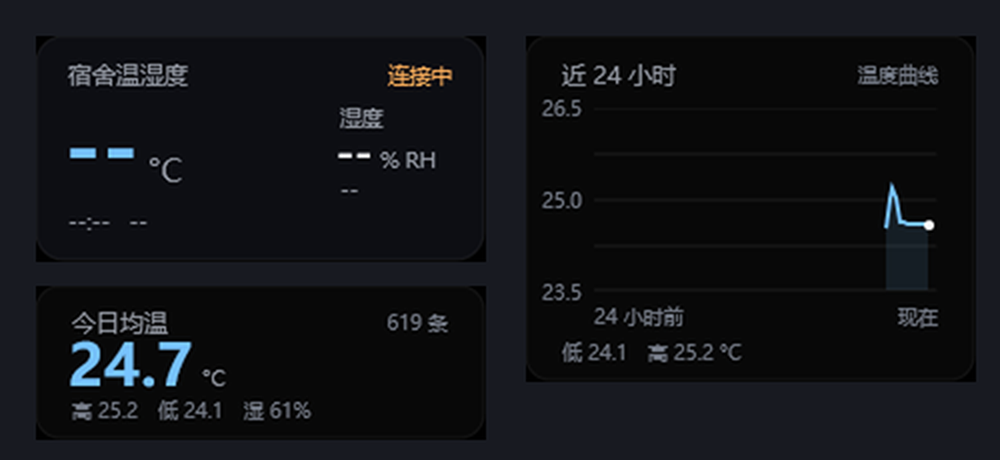

# DormTemp Monitor · 米家温湿度计 3 mini 的 Rainmeter 皮肤（原生插件版）

[](https://github.com/kmizmal/DormTempPlugin/actions/workflows/build.yml)

显示米家温湿度计 3 mini（`MJWSD06MMC`）的温度、湿度、电池电压与舒适度，
数据由随包安装的 **原生 DLL 插件** 直接读 BLE GATT，不需要 Python、.NET 或任何后台进程。

> 非官方项目：与小米公司没有任何关系，不修改、不写入设备，数据只留在本机。
> 详见[免责声明](#七免责声明)。



```
DormTempMonitor/
├─ DormTempMonitor.ini              主面板：只显示实时数据（224×112）
├─ @Resources/
│  ├─ Theme.inc                     颜色 / 字体 / 通用样式（所有皮肤共用）
│  ├─ Card.inc                      一张汇总卡片的外观（三张卡共用一份定义）
│  └─ Chart.inc                     一张曲线卡的外观
└─ Cards/                           可选皮肤，各自独立文件夹 = 可自由组合同时激活
   ├─ Today/Today.ini               今日汇总
   ├─ Day/Day.ini                   近 24 小时汇总
   ├─ Week/Week.ini                 近 7 天汇总
   ├─ ChartToday/ChartToday.ini     今日曲线
   ├─ ChartDay/ChartDay.ini         近 24 小时曲线
   └─ ChartWeek/ChartWeek.ini       近 7 天曲线
```

主面板不塞东西：**汇总卡片、历史曲线都是独立皮肤**，想要哪张就激活哪张。

## 皮肤

- 数值与单位分开渲染：数值用强调色 + `FontWeight=600`，单位用暗色小字号。
  字号与纵向微调都在 `[Variables]`：`UnitSizeTemp`、`UnitSizeHum`、`UnitOffsetTemp`、`UnitOffsetHum`。
  单位用 `StringAlign=LeftBottom` 锚在数值底边，数值宽度变了也不会错位。
- 鼠标：**右键**面板打开数据目录。右键动作会顶掉该区域的 Rainmeter 上下文菜单，
  需要菜单时用托盘图标。
- 可选汇总卡片（`Cards\Today|Day|Week`）：每张给「均温 + 最高 + 最低 + 湿度均 + 样本数」，
  数字全部来自 SQLite 聚合，不是把历史采样塞进内存；悬停卡片可看极值出现的时刻。
- 可选曲线卡（`Cards\ChartToday|ChartDay|ChartWeek`）：插件把区间采样分桶后画成 PNG，
  皮肤只负责贴图。**温度和湿度画在同一张图上**：温度走左轴（蓝），湿度走右轴（绿），
  透明底 + 网格 + 折线 + 末端点；两轴各三档刻度、左侧「起始时间」右侧「现在」，
  底部两行分别给温度和湿度在区间内的最低 / 最高。
- 想在卡片里改区间：`Cards\<名字>\<名字>.ini` 的 `[Variables]` 里改 `CardWindow`（只有
  Today / 24h / 7d）；曲线卡还能把 `ChartWindow` 留空、写 `ChartHours=48` 要任意小时数，
  `ChartSeries=Both`（默认）双轴同图，写 `Temp` 或 `Hum` 就只画一条。

measure 的 `Type` 一览（`Window` 只对汇总 / 曲线类生效，取值 `Today` / `24h` / `7d`）：

| 类别 | `Type` | 说明 |
| --- | --- | --- |
| 实时 | `Temperature` `Humidity` `Voltage` | 当前读数（`GetString` 已按位数格式化） |
| 实时 | `LastUpdate` `Status` `Battery` `Comfort` `Mac` | 时间 / 连接状态 / 电量档位 / 舒适度 / 设备 MAC |
| 实时 | `SampleAge` `Online` | 距上次采样的秒数、是否在线（给条件判断用） |
| 汇总 | `TempAvg` `TempMax` `TempMin` | 窗口内温度均值 / 最高 / 最低 |
| 汇总 | `HumAvg` `HumMax` `HumMin` | 窗口内湿度均值 / 最高 / 最低 |
| 汇总 | `TempMaxAt` `TempMinAt` | 最高 / 最低出现的时刻（跨天带日期） |
| 汇总 | `Samples` `Summary` | 样本条数、一行文字摘要（给 tooltip 用） |
| 曲线 | `Chart` | 渲染结果：PNG 绝对路径（直接喂 `Image` meter） |
| 曲线 | `ChartHi` `ChartMid` `ChartLo` | 左轴（温度）三档刻度值 |
| 曲线 | `ChartHi2` `ChartMid2` `ChartLo2` | 右轴（湿度）三档刻度值，`Series=Both` 时才有值 |
| 曲线 | `ChartMin` `ChartMax` `ChartMinAt` `ChartMaxAt` | 区间内极值与出现时刻（`Series=Hum` 取湿度的） |
| 曲线 | `ChartSpan` `ChartSeries` | 「24 小时前」这类时间轴文案、当前序列名（双轴时为「温度 / 湿度」） |

曲线类共用 `Chart=<key>` 指定同一份渲染结果（同一个 key 只画一次），
其余选项写在 `Type=Chart` 的那个 measure 上：`Hours` / `Buckets` / `Width` / `Height` /
`Series=Both|Temp|Hum` / `Color=r,g,b` / `Color2=r,g,b`。

## 一、架构

```
Rainmeter 主线程                采集线程（DLL 内）              BLE 设备
────────────────              ─────────────────────           ────────
[MeasureTemp].Update()
   │ 只读快照                 ble::start() 起一个线程
   ▼                              │ init_apartment(MTA)
Snapshot（SRWLOCK 保护）◀────────┤ scan（Active 扫描）
   ▲                              │ connect → 服务/特征发现
   │                              │ 订阅 CCCD（Notify，失败退 Indicate）
   └── state::publish ────────────┤ 首次 ReadValue + 每 30s 保活
                                  │ 断线 → 重连；空闲 60s → 脱手
                                  ▼
                            store::sample() → SQLite
```

关键设计：**采集永远不在主线程**。`Update`/`GetString` 只读一份加锁快照，
蓝牙往返（设备休眠时要等超时）不会卡住 Rainmeter 的任何一帧。

## 二、模块职责

| 文件 | 职责 | 依赖 |
| --- | --- | --- |
| `Plugin.cpp` | Rainmeter API v3 导出（Initialize/Reload/Update/GetString/ExecuteBang/Finalize） | 全部 |
| `BleSession.cpp` | 唯一的 WinRT 出口：扫描、连接、订阅、保活、重连 | WinRT |
| `SharedState.cpp` | 快照读写 + 状态文案 / 电量 / 舒适度（纯函数，可测） | 无 |
| `DormProtocol.cpp` | 5 字节通知负载解析、广播名匹配（纯函数，可测） | 无 |
| `Config.cpp` | 皮肤选项、数据目录、MAC 解析/格式化、上次设备记忆 | 无 |
| `Store.cpp` | SQLite 落盘 + 区间聚合（动态加载系统 `winsqlite3.dll`） | winsqlite3 |
| `Stats.cpp` | 今日 / 24 小时 / 7 天汇总缓存（采集线程重算，主线程只读） | Store |
| `Chart.cpp` | 历史曲线：分桶取值 → GDI+ 画 PNG；自带渲染线程，40 秒节流 | Store, gdiplus |
| `Log.cpp` | 追加写 `plugin_debug.log` | 无 |
| `RainmeterApi.cpp` | 从 `Rainmeter.dll` 动态取 `RmReadString` | 无 |
| `RoShim.cpp` | 补 mingw 缺的 `RoGetActivationFactory` / `RoOriginateLanguageException` | 无 |

## 三、协议

广播名 `MJWSD06MMC`（或广播里带服务 `ebe0ccb0-…`），特征 `ebe0ccc1-…`，
订阅后推送 **5 字节小端**：

| 偏移 | 类型 | 含义 | 换算 |
| --- | --- | --- | --- |
| 0..1 | int16 | 温度 | ÷100 ℃ |
| 2 | uint8 | 湿度 | %RH |
| 3..4 | uint16 | 电压 | ÷1000 V |

少于 5 字节判无效；多余字节忽略。电量档位按电压：≥3.0V 充足、≥2.7V 偏低、其余需更换。

## 四、构建与测试

```bash
python build_plugin.py                 # 只构建 + PE 校验
python build_plugin.py --test          # 构建 + 跑 189 项测试
python build_plugin.py --probe         # 另外构建 DormProbe.exe
python build_plugin.py --install       # 构建并写入两个插件目录
```

`PE 校验` 每次都会检查：machine 必须是 x64、6 个导出齐全、
导入表里不能出现 `msvcp/vcruntime/libstdc++/libwinpthread`（说明没静态链接）。

> 克隆后第一次构建需要先生成 `winrt_gen/`：它是 64 MB 的 cppwinrt 投影头，属于生成物、
> 不入库。跑一次 `cppwinrt.exe -in %WINDIR%\System32\WinMetadata -out winrt_gen`
> 就行，之后每次构建直接沿用。构建依赖 zig（`../tools/zig/zig.exe`）与 Windows 10+ 自带的
> `winsqlite3.dll`。

不想在本机装工具链：`.github/workflows/build.yml` 在 push / PR 上跑同一套命令——
取 SDK 自带的 `cppwinrt` 生投影头（按 SDK 版本缓存）→ zig 编译 → 189 项测试 →
打包，`.rmskin`、`DormTemp.dll`、`DormProbe.exe` 作为 artifact 挂在构建页（保留 30 天）。
工作流不碰 **Releases**：发版是人工行为，自动产物只留在 Actions 里。

探测工具（对应 MCHOSE 项目的 HidProbe）：

```bash
dist/DormProbe.exe scan 8                 # 列出周边广播：MAC / RSSI / 名称 / 是否命中
dist/DormProbe.exe read AA:BB:CC:DD:EE:FF 20   # 连接并打印通知
dist/DormProbe.exe db                     # 看正式库里已有多少条记录（顺带打印三个窗口汇总）
dist/DormProbe.exe chart "" 24            # 把近 24 小时画成 PNG，验证曲线外观
dist/DormProbe.exe chart "" 24 both       # 温湿度双轴（和皮肤里的曲线卡一致）
dist/DormProbe.exe chart "" 168 hum       # 只画湿度，近 7 天
```

`read`/`scan` 的临时数据落在 `%TEMP%\DormProbe`，不会污染皮肤在用的数据库。

## 五、打包与部署

不想自己编：**Releases** 里有打好的 `DormTempMonitor_<版本>.rmskin`，双击就能装。

```bash
python build_package.py            # 产出 dist/DormTempMonitor_<皮肤 Version>.rmskin
python build_package.py --install  # 同时投影到本机（皮肤 + 两个插件目录）
```

打包时做的四件容易被忽略的事：

1. `.ini` 转 **UTF-16 LE + BOM + CRLF**。Rainmeter 不认 UTF-8（中文会乱码并报
   `Invalid Substitute`），而 LF 换行会让新插入的段落粘到上一行、整段不被解析。
2. DLL 放进包内 `Plugins/64bit/`。安装器按宿主位数选目录，放 `Plugins/` 根目录不识别。
3. `.rmskin` 末尾追加 16 字节 `PackageFooter`（`{int64 size; uint8 flags; char key[7]}`），
   少了它安装器按 `strcmp(key,"RMSKIN")` 判定失败，直接拒绝这个包。
4. `LICENSE.txt` 与 `README.md`（含免责声明）一并放进皮肤目录：GPL 分发二进制时要附带许可全文，
   免责声明也该跟着安装包走，不能只留在仓库里。打包自检会核对这一项。

## 六、已知限制

1. 传感器休眠时不广播，**必须先按一下侧键唤醒**，否则扫描只能看到别的 BLE 设备。
2. 只出 x64 产物（当前 Rainmeter 为 64 位）；32 位宿主会静默加载失败。
3. `winsqlite3.dll` 是 Win10/11 组件；缺失时插件仍能显示，但不再落盘（日志写一行说明）。
4. 皮肤未激活且静默 60 秒后进待机，不再扫蓝牙；重新加载皮肤即恢复。
5. 同一秒内的多条通知只入库一条（去重），这是刻意行为。
6. 首次连接会在数据目录写 `device_mac.txt` 记住设备；固定 `MacAddress` 后不再写。
7. 连接期间每 30 秒读一次做保活，比纯手抄略费电；皮肤静默 60 秒后进待机就不再扫蓝牙。

## 七、免责声明

**名称与商标归小米。** 「小米」「Xiaomi」「米家」「MIJIA」、`米家温湿度计 3 mini`、`MJWSD06MMC`
等产品名称、商标与相关素材，所有权归小米科技有限责任公司及其关联公司。本仓库在标题、文档
和皮肤里用这些名称，只是为了**说明兼容的设备型号**（描述性使用），不代表小米公司对本项目的
授权、认可或背书。本仓库的代码本身由本仓库作者享有著作权，按 [GPL-3.0](LICENSE) 授权——
两者不冲突：名字是别人的，代码是这里的。

**本项目与小米公司无关。** 这是第三方、非官方、个人维护的开源项目，不是小米的产品、服务或
官方支持内容，也未获得小米的授权、认可或赞助。与本皮肤有关的问题请提到本仓库的 Issues，
不要联系小米客服。

**不修改产品，也不动设备。** 插件只做一件事：用 Windows 自带的蓝牙栈连接设备，订阅它本来
就对外提供的标准 BLE GATT 特征 `ebe0ccc1-…`，读设备主动推送的 5 字节通知。不刷固件、不拆
硬件、不向设备写入任何数据、不破解配对或链路加密、不绕过任何授权机制——设备的固件、行为与
保修状态都不因使用本项目而改变；读到的只是设备公开广播 / 通知的数据，不含任何从固件或官方
App 里提取的内容。

**数据不出本机。** 采样只写入本机 SQLite（默认 `%APPDATA%\Rainmeter\DormTemp\`），无账号、
无云端、无任何网络上报；删掉这个目录就等于清空全部历史。

**风险自担。** 软件按「现状」提供，不附带任何明示或暗示的担保，包括适销性、特定用途适用性
与不侵权。因使用或无法使用本软件造成的设备异常、数据丢失、时间损失或其他损害，作者不承担
任何责任。要不要装、装在哪台机器上，请自行判断。

**关于名称使用。** 若权利人认为本仓库中某个名称、截图或素材使用不当，请在 Issues 里说明，
我会尽快改名或删除。

## 八、致谢

协议结论和产品形态都来自上游 [**dorm-temp-monitor**](https://github.com/cxzxx783/dorm-temp-monitor)（MIT）：
设备名 `MJWSD06MMC` 的识别方式、特征 `ebe0ccc1-…`、5 字节小端负载的换算、电压三档电量，
以及「电脑自带蓝牙直读、不要网关、数据不出本机」这个思路，都是那边先摸出来的。

上游是 Python + pywebview + ECharts 的桌面程序，每天一个 CSV；这里把采集换成了 Rainmeter 的
原生 DLL（C++/WinRT），存储换成 SQLite，界面换成皮肤 + 可选卡片。想跑那个版本请直接去上游。

## 九、许可

**GPL-3.0**，全文见 [LICENSE](LICENSE)。上游是 MIT，与本项目的 GPL-3.0 兼容。
